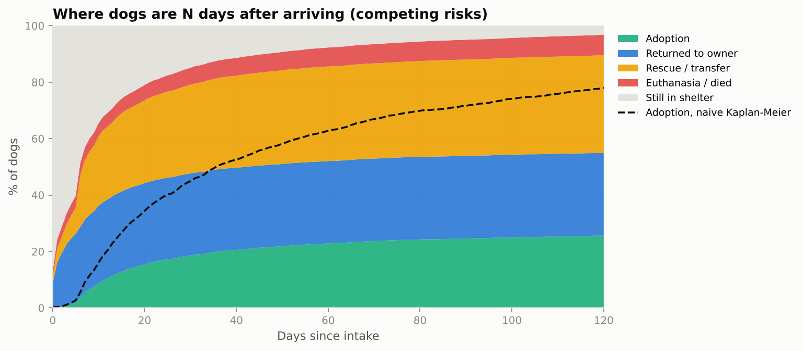
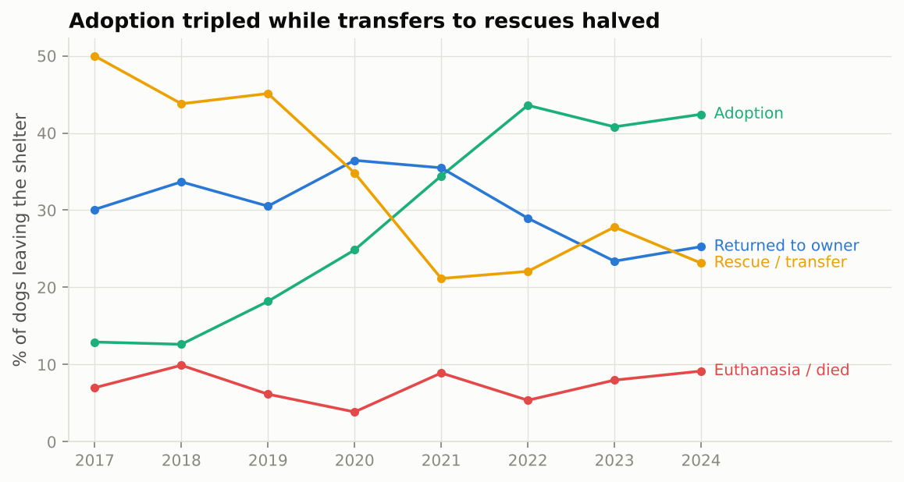
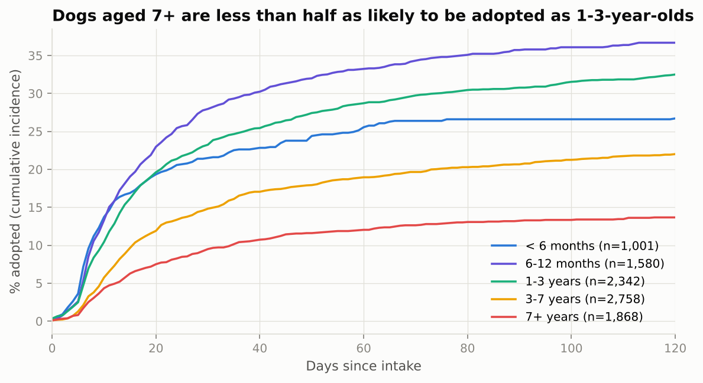
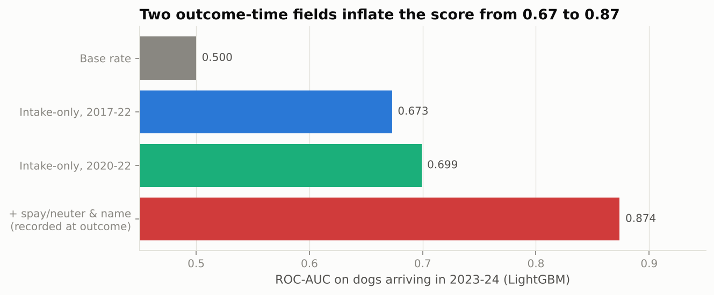
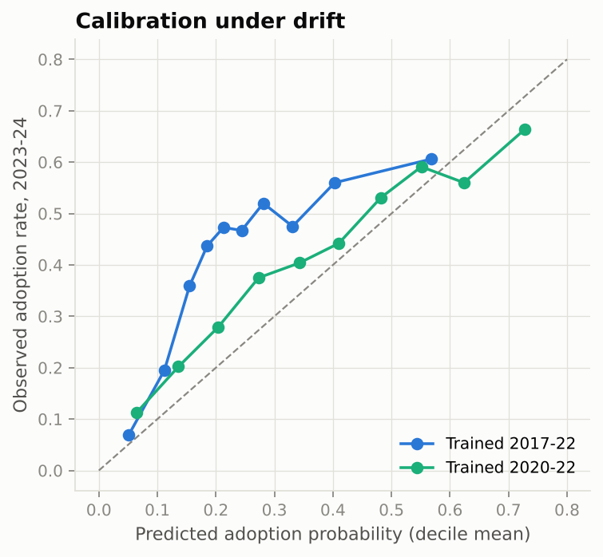

# Dog Adoption at a Public Shelter: What Happens After Intake, and What Can Be Predicted

[](https://github.com/c4r0l13/dog-adoption-analysis/actions/workflows/ci.yml)


An analysis of **9,750 dog stays** at the City of Long Beach (California) animal shelter, 2017–2024. It answers two questions a shelter team actually asks:

1. **What happens to a dog after it arrives, and how fast?** This uses competing-risks survival analysis, because a dog that goes home to its owner can no longer be adopted.
2. **On the day a dog arrives, can we tell which dogs will struggle to be adopted?** This uses a model restricted to information known at intake, tested on later years, with a leakage audit.

> *Resumen en español:* análisis de 9,750 estancias de perros en el refugio municipal de Long Beach (2017–2024). Con análisis de supervivencia con riesgos competitivos se estima qué pasa con cada perro y en cuánto tiempo. Un modelo que solo usa datos del día de ingreso identifica qué perros tendrán más dificultad para ser adoptados. El proyecto muestra dos errores comunes que inflan los resultados: el Kaplan-Meier ingenuo (85% "adoptados" contra 27% reales) y dos columnas que se registran al salir del refugio (AUC de 0.67 a 0.87).

## Key findings

| | Result |
|---|---|
| Dogs adopted within 180 days (Aalen-Johansen) | **26.6%** |
| Same quantity with a naive Kaplan-Meier | 85.5%, which overstates it by 3.2x |
| Adoption share of outcomes, 2017 → 2024 | **13% → 42%** |
| Adopted within 90 days: 1–3 years vs 7+ years | 30.8% vs **13.2%** |
| Adoption model ROC-AUC on 2023–24 (intake data only) | **0.70** |
| Same model with two outcome-time fields | 0.87, a leak |

## 1. What happens after intake



Each dog leaves the shelter by one of four routes. The stacked areas are **cumulative incidence functions**: the share of dogs that have left by each route *N* days after arriving.

- **Within a week**, 26% have gone home to their owner and 21% have gone to a rescue group or partner shelter. Only 5.5% have been adopted by then, because adoption needs a hold period, a medical check and spay/neuter surgery.
- **After 30 days**, 85% have left. The adoption curve keeps rising until about day 90.
- **The dashed line is the common mistake.** A standard Kaplan-Meier "time to adoption" treats dogs returned to owners or transferred as censored, as if they were still waiting to be adopted. It claims 85% are adopted by day 180, when the real figure is 27%.

### The shelter changed a lot in eight years



Adoption grew from 13% to 42% of outcomes, while transfers to rescue groups fell from 50% to 23%. The data cannot say *why*. Policy, staffing, the pandemic and local adoption programmes all changed in this period. Any model trained on old years has to deal with this shift (see section 2).

### Age matters most



Young adult dogs (6 months to 3 years) are the most likely to be adopted. Dogs aged 7+ have less than half the adoption incidence. Many seniors go home to an owner (45%), but they also have the highest euthanasia share (11.5%, against about 5% for dogs under 3). Puppies under 6 months are adopted less than juveniles, because 60% of them go to rescue or partner organisations, often because they arrive under-age.

Among dogs that *were* adopted, the median wait is 10 days for puppies and about 20 days for dogs over 3.

## 2. Predicting adoption at intake

The model predicts whether a dog's stay will end in adoption. It uses only fields known when the dog arrives: age, sex, intake condition, intake type and subtype, colour, jurisdiction and month. It is trained on earlier years and **tested on all dogs arriving in 2023–24** (2,767 dogs).

| Model | ROC-AUC | PR-AUC | Brier |
|---|---:|---:|---:|
| Base rate (no model) | 0.500 | 0.416 | 0.283 |
| Logistic regression, trained 2017–22 | 0.647 | 0.532 | 0.257 |
| LightGBM, trained 2017–22 | 0.673 | 0.558 | 0.250 |
| Logistic regression, trained 2020–22 | 0.692 | 0.583 | **0.216** |
| **LightGBM, trained 2020–22** | **0.699** | **0.590** | 0.218 |

### Leakage audit



Two columns look like strong predictors but are **recorded at outcome time**:

- `sex` mixes biological sex with spay/neuter status, and the shelter alters dogs *before* adoption. 47–50% of "Neutered/Spayed" dogs were adopted, against 8–9% of "Male/Female" dogs.
- `animal_name` is often given to a stray only when it is put up for adoption. 2% of unnamed dogs were adopted.

Adding them raises ROC-AUC from 0.67 to 0.87. That gain is not real, because the model would be reading the answer from the record. The clean model keeps only biological sex, and treats both fields as off-limits.

### Drift: older data hurts



The adoption rate in the training years (21.6%) is half the rate in the test years (41.6%). A model trained on 2017–22 **under-predicts systematically**. Training on 2020–22 only uses one third of the data but improves every metric and is close to calibrated. For a shelter, this means **retraining regularly on a recent window** instead of accumulating history.

### What drives the prediction

Permutation importance on the test years: **age** dominates (ROC-AUC drop 0.12), then intake condition (0.03), intake type (0.02) and subtype (0.02). Colour, jurisdiction and sex add almost nothing.

### What an AUC of 0.70 is good for

It is not a decision tool for individual dogs. It is useful as a **triage list**: the bottom decile of predicted probability has a 7–11% observed adoption rate, against 60–66% in the top decile. Dogs that start on the bottom of the list (older, in poor condition, seized or under quarantine) are candidates for early promotion, foster placement or a rescue partner, *before* they spend weeks in a kennel.

## Limitations

- **Descriptive, not causal.** The data shows which dogs are adopted less, not *why*. Age is entangled with health, behaviour and breed, which are not in the data.
- **No breed or size fields.** These usually matter for adoption and are missing in this export.
- **Recent stays are partly open.** 135 dogs were still in the shelter at the end of 2024. The survival analysis handles them as censored. The model excludes them, which slightly favours quick outcomes in late 2024.
- **One shelter.** Long Beach operates in a specific policy context. Rates should not be generalised to other shelters.

## How to run

```bash
make install   # pip install -e ".[dev]"
make data      # downloads a ~7 MB CSV
make run       # reports/results.md, reports/metrics.json, reports/figures/ (~30 s)
make test
```

## Project structure

```
dog-adoption-analysis/
├── scripts/download_data.py   # Long Beach open data (via TidyTuesday)
├── src/adopt/
│   ├── data.py                # cleaning, outcome groups, intake-time fields, censoring
│   ├── survival.py            # Aalen-Johansen cumulative incidence + naive KM for comparison
│   ├── model.py               # intake-only adoption model, temporal split, leakage audit, drift
│   └── pipeline.py            # figures and reports
├── tests/                     # cleaning rules and survival estimators on hand-computed cases
└── reports/                   # results.md, metrics.json, figures/
```

## How this project evolved

The first version was my BEDU *Procesamiento de datos con Python* module project, "Análisis de adopción responsable de perros" (2024, [MODULO-3-PYTHON](https://github.com/caro1ie/MODULO-3-PYTHON)). It explored a synthetic Kaggle pet-adoption dataset in a notebook and used the Dog CEO API for breed images. This rebuild:

- replaces the synthetic data with **real shelter records** (9,750 dog stays over 8 years);
- adds **competing-risks survival analysis**, which handles the fact that dogs leave the shelter in different ways;
- adds a forward-in-time **model evaluation with a leakage audit** and a drift analysis;
- turns the notebook into a tested Python package with CI.

## Data and credits

City of Long Beach Animal Care Services, intake and outcome records published on the [Long Beach open data portal](https://data.longbeach.gov/) and curated by [TidyTuesday (2025-03-04)](https://github.com/rfordatascience/tidytuesday/tree/main/data/2025/2025-03-04). Data not included in this repository.
